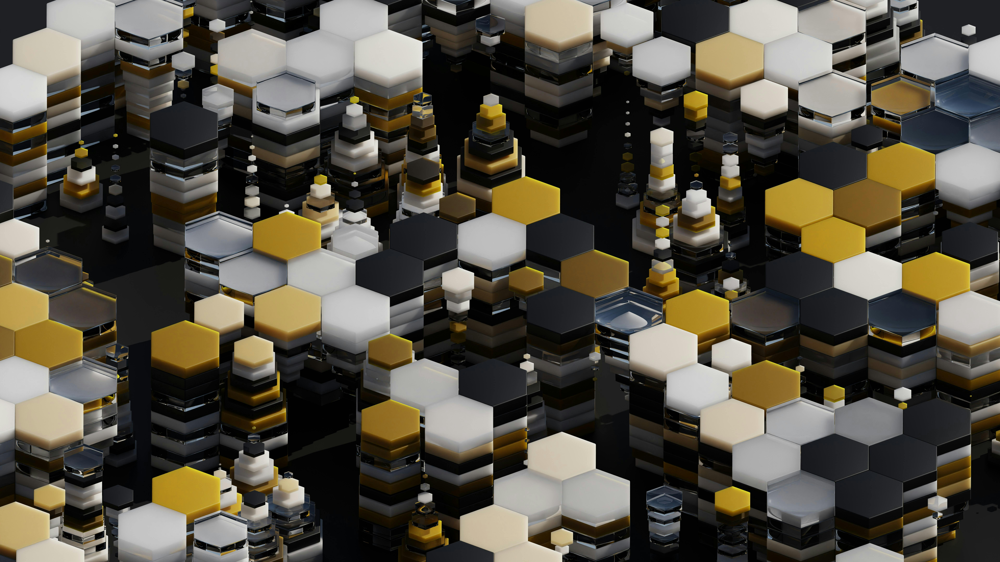
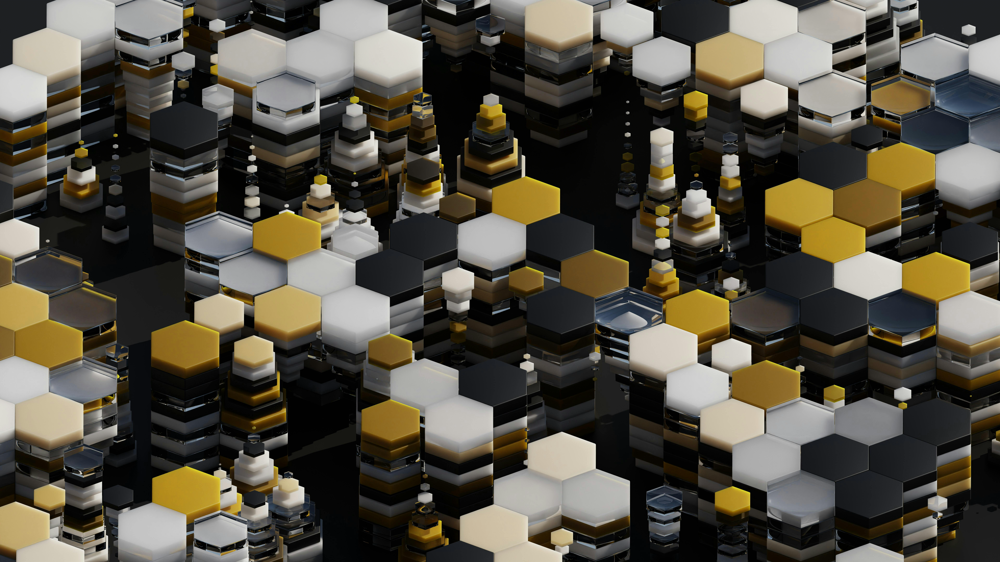
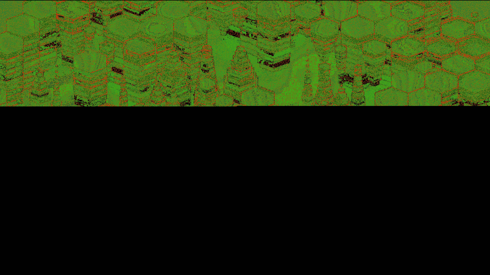

# Hide

[](https://goreportcard.com/report/github.com/andresmejia3/hide)
[](https://github.com/andresmejia3/hide/actions)
[](https://opensource.org/licenses/MIT)
[](https://go.dev/)

**Hide** is a steganography tool written in Go. It conceals files inside images using three embedding strategies, authenticated encryption (AES-256-GCM or RSA-OAEP hybrid), and Reed-Solomon error correction.

Unlike simple LSB tools, **Hide** is built for reliability and security, featuring Reed-Solomon error correction to handle data corruption and support for both symmetric (AES) and asymmetric (RSA) encryption.

## Features

*   **Multiple Encoding Strategies**:
    *   **LSB (Least Significant Bit)**: High capacity, standard steganography.
    *   **LSB Matching**: Improved security against statistical analysis (histogram attacks).
    *   **DCT (Discrete Cosine Transform)**: Embeds 1 bit per 8×8 block in the frequency domain, spreading changes across the block for lower visual impact.
*   **Strong Encryption**:
    *   **AES-256**: Encrypt messages with a passphrase.
    *   **RSA**: Asymmetric encryption using public/private keys for secure message sharing.
*   **Reliability**:
    *   **Reed-Solomon Error Correction**: Splits each chunk into 4 data + 2 parity shards with a CRC32 per shard, so up to 2 damaged shards per chunk are detected and rebuilt.
    *   **Compression**: Automatically compresses data (Zlib) before embedding to maximize storage space.
*   **Analysis Tools**:
    *   **Capacity Calculator**: Check exactly how much data fits in an image before starting.
    *   **Steganalysis**: Compare original and stego images to calculate PSNR (Peak Signal-to-Noise Ratio) and generate difference heatmaps.
    *   **Integrity Verification**: Check every shard of a hidden payload without decrypting or writing it out.
*   **Performance**: Uses concurrent processing for computationally intensive tasks like DCT embedding.
*   **Stealth Engineering**:
    *   **HVS Optimization**: The DCT strategy embeds only in the Blue channel, which the human eye resolves least sharply, so changes are harder to see.

## Table of Contents

- [Features](#features)
- [Installation](#installation)
- [Usage](#usage)
- [Visual Demo](#visual-demo)
- [Strategies Explained](#strategies-explained)
- [Limitations](#limitations)
- [Testing](#testing)
- [License](#license)

## Installation

### Using Go Install

If you have Go installed and just want the binary:

```bash
go install github.com/andresmejia3/hide/cmd/hide@latest
```

### From Source

Ensure you have [Go](https://go.dev/) installed (1.21+ recommended).

```bash
git clone https://github.com/andresmejia3/hide.git
cd hide
go build -o hide ./cmd/hide
```

## Usage

### Hiding Data (`conceal`)

Hide a text message or a file inside an image.

**Basic Usage (Passphrase):**
```bash
./hide conceal -i input.png -o output.png -m "Secret Message" -p "my-secret-password"
```

**Hide a File:**
```bash
./hide conceal -i input.png -o output.png -f secret.pdf -p "my-secret-password"
```

**Using RSA Encryption:**
First, generate keys (see below), then encrypt for the recipient using their public key.
```bash
./hide conceal -i input.png -f secret.txt -k public.pem
```

**Advanced Options:**
*   `-n 2`: Use 2 bits per channel (higher capacity, slightly more visible artifacts).
*   `--dry-run`: Check if the data fits without actually writing the file.
*   `-c 3`: Specify number of RGBA channels to use (1-4).
*   `-z false`: Disable Zlib compression (enabled by default).
*   `-w 4`: Set specific number of concurrent workers (defaults to CPU count).

### Extracting Data (`reveal`)

Recover the hidden message or file.

**Basic Usage:**
```bash
./hide reveal -i output.png -p "my-secret-password"
```

**Save to File:**
```bash
./hide reveal -i output.png -p "my-secret-password" -o recovered_secret.pdf
```

**Using RSA Decryption:**
```bash
./hide reveal -i output.png -k private.pem -o recovered.txt
```

### Analysis & Utilities

**Check Capacity:**
See how many bytes you can hide in an image using different strategies.
```bash
./hide capacity input.png
```

**Inspect Header:**
View metadata (strategy, channels used, compression status) without decoding the payload.
```bash
./hide info stego_image.png
```

**Verify Integrity:**
Check if a hidden message is intact using Reed-Solomon checks without extracting the full payload.
```bash
./hide verify -i stego_image.png -p "my-secret-password"
```

**Analyze Differences:**
Compare an original image with a stego image to see how much it changed (MSE/PSNR) and generate a heatmap.
```bash
./hide analyze -o original.png -s stego.png -d heatmap.png
```

### Key Generation (`keys`)

Generate RSA public/private key pairs for asymmetric encryption.

```bash
./hide keys -o ./keys -b 2048
```

## Visual Demo

Concealing an **18.8 KB PDF** (`testdata/test.pdf`) into a 7680×4320 photo using the default DCT strategy:

| Original Image | Stego Image (Hidden PDF) | Difference Heatmap |
| :---: | :---: | :---: |
|  |  |  |
| **Clean** | **Encrypted & Compressed** | **Modified Pixels** |

### Analysis Results

```bash
./hide analyze -o assets/original.jpg -s assets/stego.png
```

* **MSE (Mean Squared Error):** 0.80
* **PSNR (Peak Signal-to-Noise Ratio):** 49.08 dB *(above ~40 dB is generally considered visually indistinguishable)*

### Capacity vs. Quality

DCT stores 1 bit per 8×8 block of the Blue channel, so this image holds 64,680 bytes in total. That has to fit the compressed, encrypted payload plus Reed-Solomon parity. Random data cannot be compressed, so it is the worst case:

| Hidden data | Stored in image | Share of DCT capacity | PSNR |
| --- | --- | --- | --- |
| 18.8 KB PDF (`testdata/test.pdf`) | 24,898 bytes | 38% | 49.08 dB |
| 40 KB random bytes | 61,546 bytes | 95% | 45.30 dB |

The random file is reproducible: `python3 -c "import random; random.seed(777); open('rand40k.bin','wb').write(random.randbytes(40960))"` (SHA-256 `a810358a7f23dd0f9835066aa92f02b2229e3a1fa7598a8a4ccfc3419d2fc814`).

LSB uses every pixel, so it holds roughly 200× more in the same image, at the cost of being far easier to detect statistically.

### Stego Header Info

```text
$ ./hide info assets/stego.png
Stego Header Information:
-------------------------
Strategy:         dct
Channels Used:    1
Bits Per Channel: 1
Compressed:       true
Payload Size:     24898 bytes
```

## Strategies Explained

*   **LSB (Least Significant Bit)**: Replaces the lowest bits of pixel color values. It offers the highest storage capacity but is fragile to image editing (resizing, compression).
*   **LSB Matching**: Similar to LSB but randomly adds or subtracts 1 to match the target bit. This alters the statistical footprint less than standard replacement, making it harder to detect via histogram analysis.
*   **DCT**: Embeds data into the frequency domain of 8x8 pixel blocks. The quantization step adapts to each block's texture, and each write is re-checked after rounding to 8-bit pixels.
*   **Blue-Channel Embedding (DCT)**: DCT embeds only in the Blue channel, because the human eye has the lowest spatial resolution for blue light.

## Limitations

*   **Output must stay lossless (PNG).** The header is stored in pixel LSBs, so any lossy re-save, even JPEG at quality 100, destroys it. JPEG covers work fine as *input*. `TestJPEGCompressionResilience` in `pkg/stego/stego_test.go` asserts this behaviour.
*   **Reed-Solomon recovers up to 2 damaged shards per chunk.** Damage spread across more shards (for example, scattered bit flips when a passphrase randomizes pixel order) cannot be rebuilt and is reported as an error.
*   **Hidden data is encrypted, but its presence is not hidden from someone who knows the tool,** because the header layout is fixed.

## Testing

To run the test suite:

```bash
go test ./...
```

## License

MIT
